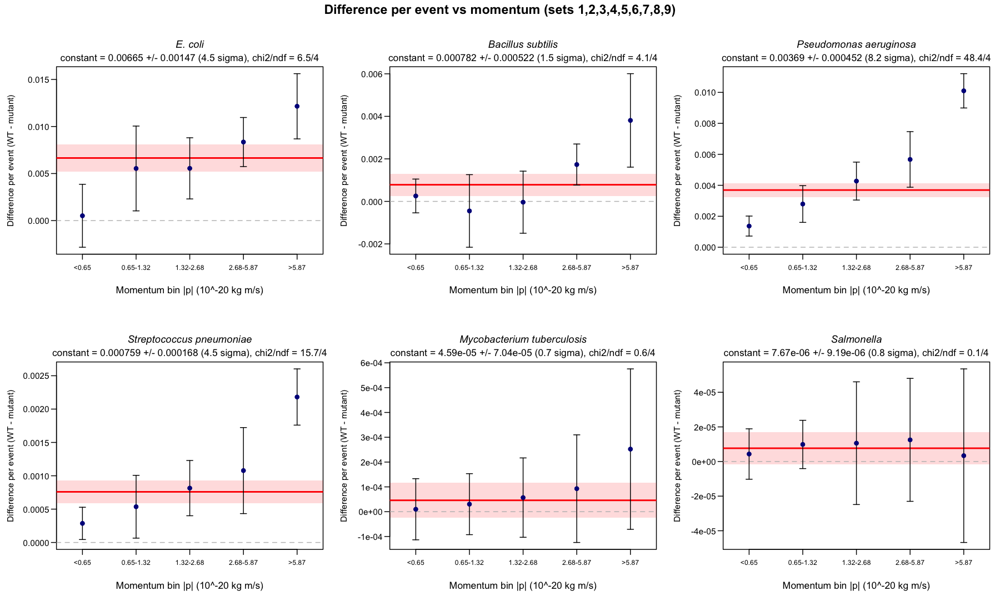
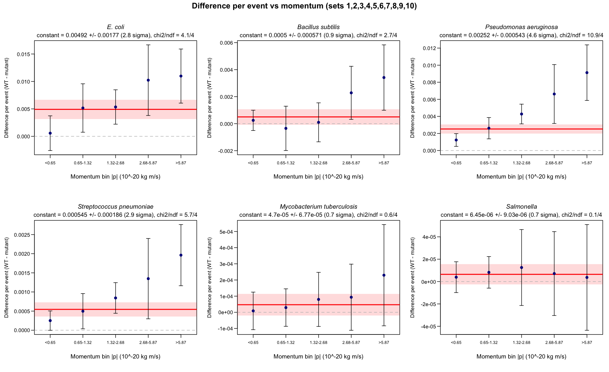
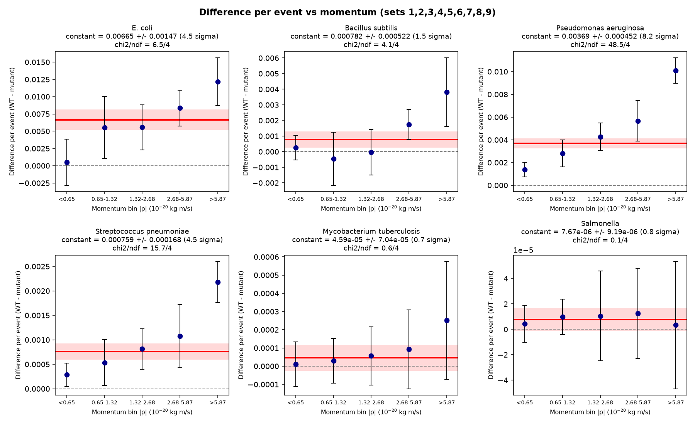

# PRA2003: Bacterial Population Analysis (Biology Track)

Julia Waldmeier

## 1. Overview

This project analyzes simulated experimental data representing bacterial
populations across millions of independent "events" (runs). Each event
contains a variable number of bacteria, each tagged with an ID code
identifying its strain (see table below). Using the full 5,000,000-event
dataset, this report answers three questions:

1. What is the **average number of each of the 12 strains per event**, and
   its **statistical uncertainty**? (section 4)
2. Is there an **asymmetry** between the wild-type (WT) and the mutant form
   of each strain, i.e. is one seen more often than the other? (section 5)
3. Does that WT − mutant difference **depend on the momentum** of the
   bacteria? (section 7)

## 2. Data

- 10 data files (`output-Set1.txt` ... `output-Set10.txt`), ~500,000 events
  each, ~800MB per file, available from the course surfdrive, not included
  in this repository due to size.
- Each file is plain text, structured as repeating blocks:
  ```
  <eventNumber> <nParticlesInEvent>
  <px> <py> <pz> <bacterialID>       (one line per bacterium, repeated
  ...                                 nParticlesInEvent times)
  ```
- Some events contain 0 bacteria (e.g. a header line like `77 0`). These
  are excluded from the event count used to calculate averages, since
  nothing was observed in them.

### Bacterial ID → strain mapping

| ID    | Strain                                        |
| ----- | --------------------------------------------- |
| 211   | *E. coli* WT (wild type)                      |
| -211  | *E. coli* mutant                              |
| 321   | *Bacillus subtilis* WT                        |
| -321  | *Bacillus subtilis* mutant                    |
| 2212  | *Pseudomonas aeruginosa* WT                   |
| -2212 | *Pseudomonas aeruginosa* antibiotic-resistant |
| 3122  | *Streptococcus pneumoniae*                    |
| -3122 | Capsule-deficient *S. pneumoniae*             |
| 3312  | *Mycobacterium tuberculosis*                  |
| -3312 | Drug-resistant *M. tuberculosis*              |
| 3334  | *Salmonella enterica*                         |
| -3334 | *Salmonella* mutant                           |

## 3. Method

All three questions use the same basic approach, the **sub-sampling
method**: each of the 10 data files is treated as an independent
sub-sample and analysed on its own, giving one result per file. The 10
results are then combined into a mean, and the **standard deviation of the
10 values is the statistical uncertainty**. The significance of a result is
the mean divided by its uncertainty; a result of at least 3σ is called
significant.

The 10 files disagree with each other more than the simple Poisson formula
(`sqrt(count)`) predicts (see section 6 for the numbers). Bacteria within
an event are not showing up purely independently of each other, so the
counts swing more from file to file than random chance alone would cause.
That's why the uncertainty comes from directly measuring how much the 10
files disagree, rather than from the Poisson formula.

### Q1: average number of each strain per event (section 4)

**Step 1: per-file analysis** (`analyzeAllSubsamples.R`): one shared
function is run on each of the 10 files. It reads the ~800MB file in
memory-safe chunks (never loading the whole file at once), counts how many
times each of the 12 strain IDs appears, and computes for that single file:
- `average per event = total count / number of valid events`
- `uncertainty = sqrt(total count) / number of valid events` (Poisson
  statistics, see week 3; only used for the check in section 6)

**Step 2: combining the 10 sub-samples** (`Week4deliverable.R`): the 10
per-file results are combined into one overall measurement per strain:
- **Central value:** inverse-variance weighted average across the 10
  sub-samples: <br>
  `⟨x⟩ = Σ wᵢ⟨xᵢ⟩ / Σ wᵢ`, where `wᵢ = 1 / σᵢ²` (all files have almost
  the same number of events, so this is practically the same as the plain
  average)
- **Uncertainty:** the standard deviation of the 10 sub-sample averages.

### Q2: asymmetry between WT and mutant (section 5)

(`asymmetryTest.R`) For each pair, the difference is computed **within
each of the 10 files first** (`ΔNᵢ = averageᵢ(X) − averageᵢ(−X)` for
file i), rather than
subtracting the two already-combined final averages. The 10 resulting
differences are then treated the same way as any other sub-sampling
result: the mean of the 10 differences is the reported difference, and
the standard deviation of the 10 differences is the uncertainty on it
(same sub-sampling convention as section 4, no further division).

This is important since WT and mutant/resistant counts are not independent:
a file with more bacteria overall tends to have more of *both* the normal
and mutant form together. Subtracting within each file first cancels out
that shared file-to-file noise before combining, which is more accurate
than combining the two strains' already-finished uncertainties as if they
were unrelated (`sqrt(σ_WT² + σ_mutant²)`, a formula that assumes no
correlation between them, which does not hold here).

The significance is the difference divided by its uncertainty, expressed
as a number of standard deviations ("sigma"), the same scale used in the
lecture (slide 11: 3σ ≈ 1-in-740 chance of being a statistical fluctuation,
5σ ≈ discovery-level significance).

### Q3: asymmetry as a function of momentum (section 7)

(`momentumDifference.R`)

1. Every bacterium of one of the 12 strains, in all 10 files, has its
   momentum computed: `|p| = sqrt(px² + py² + pz²)` (in 10⁻²⁰ kg m/s).
2. Each bacterium is sorted into one of **5 momentum bins**. The bin
   boundaries are the 20/40/60/80% points (quantiles) of the momentum in
   Set 1, so each bin holds about 20% of the bacteria and has comparable
   statistics: **< 0.65, 0.65 – 1.32, 1.32 – 2.68, 2.68 – 5.87, > 5.87**.
   The same boundaries are used for every file. The first and last bins
   are open-ended, so every bacterium is counted.
3. For each file, strain pair and bin, the WT and mutant counts are turned
   into averages per event (exactly as in sections 4 and 5) and subtracted
   **within that file**:
   `Dᵢ = count_WTᵢ / nEventsᵢ − count_mutantᵢ / nEventsᵢ`
   This is the same quantity as in section 5 (a difference per event, not a
   ratio), so the five bins of a pair add up to its overall difference.
4. Per pair and bin, the **sub-sampling method** gives the result: the
   point is the mean of the per-file values of `Dᵢ`, the uncertainty is
   their standard deviation, and the significance is point / uncertainty.
5. A **constant** (a flat line `D = c`) is fitted through the 5 points, to
   test for an asymmetry across the momentum bins. The fit is weighted with
   `w = 1/σ²`, so more precise points count more. For a constant, the
   least-squares result is the weighted mean of the points:
   `c = Σ(w·D) / Σw`, with uncertainty `σ_c = 1/√(Σw)`. The significance is
   `c / σ_c`. The χ² of the fit, `χ² = Σ((D − c)/σ)²` with ndf = 5 − 1 = 4,
   shows whether a constant describes the points: χ²/ndf around 1 means
   yes, much larger means the difference changes with momentum.

Set 10 is left out of this analysis, because its momentum distribution is
very different from the other nine files (see section 7).

The same analysis (steps 3 to 5 and the plots) is also done in Python, in
`momentumDifference.py`, using pandas, numpy and matplotlib. It reads the
same saved counts and gives the same results (see the end of section 7).

## 4. Q1: Average number of each strain per event

Combined across all 10 sub-samples (**4,617,993 valid events**, out of
5,000,000 total, the remainder had 0 bacteria recorded):

| ID    | Strain                                        | Average per event | Uncertainty |
| ----- | --------------------------------------------- | ------------------| ------------|
| 211   | *E. coli* WT                                  |          19.94948 |   ± 0.03274 |
| -211  | *E. coli* mutant                              |          19.91716 |   ± 0.03187 |
| 321   | *Bacillus subtilis* WT                        |           2.50914 |   ± 0.00477 |
| -321  | *Bacillus subtilis* mutant                    |           2.50345 |   ± 0.00550 |
| 2212  | *Pseudomonas aeruginosa* WT                   |           1.20803 |   ± 0.00190 |
| -2212 | *Pseudomonas aeruginosa* antibiotic-resistant |           1.18416 |   ± 0.00241 |
| 3122  | *Streptococcus pneumoniae*                    |           0.27659 |   ± 0.00107 |
| -3122 | Capsule-deficient *S. pneumoniae*             |           0.27169 |   ± 0.00098 |
| 3312  | *Mycobacterium tuberculosis*                  |           0.03944 |   ± 0.00028 |
| -3312 | Drug-resistant *M. tuberculosis*              |           0.03900 |   ± 0.00040 |
| 3334  | *Salmonella enterica*                         |           0.00119 |   ± 0.00004 |
| -3334 | *Salmonella* mutant                           |           0.00115 |   ± 0.00005 |

## 5. Q2: Is there an asymmetry between WT and mutant?

Method: see section 3 (`asymmetryTest.R`).

| Strain pair                                         | Difference | Uncertainty | Significance             |
| --------------------------------------------------- | ---------: | ----------: | ------------------------ |
| *E. coli* (WT vs mutant)                            |    0.03230 |     0.00452 | **7.15σ, significant**  |
| *Bacillus subtilis* (WT vs mutant)                  |    0.00569 |     0.00329 | 1.73σ, not significant  |
| *Pseudomonas aeruginosa* (WT vs resistant)          |    0.02387 |     0.00237 | **10.07σ, significant** |
| *Streptococcus pneumoniae* (normal vs capsule-def.) |    0.00490 |     0.00058 | **8.46σ, significant**  |
| *Mycobacterium tuberculosis* (WT vs drug-resistant) |    0.00044 |     0.00049 | 0.90σ, not significant  |
| *Salmonella* (WT vs mutant)                         |    0.00004 |     0.00007 | 0.53σ, not significant  |

**Conclusion:** three of the six strain pairs show a statistically
significant difference between the normal and mutant/resistant form:
*E. coli* (7.15σ), *Pseudomonas aeruginosa* (10.07σ), and *Streptococcus
pneumoniae* (8.46σ), in each case the WT/normal form is more abundant
than the mutant/resistant form. The other three pairs (*Bacillus
subtilis*, *Mycobacterium tuberculosis*, *Salmonella*) show no significant
asymmetry; their averages agree within uncertainty.

## 6. Consistency check: do the 10 sub-samples agree with their own precision?

Each individual file reports its own Poisson uncertainty (`sqrt(count) /
nEvents`), a prediction of how much that file's answer should wobble due
to pure random counting noise alone. If that prediction is accurate, the
spread across the 10 independent files (the number used as the final
uncertainty in section 4) should come out close to that per-file Poisson
uncertainty. The ratio of the two tells us whether the naive Poisson
formula correctly describes the real spread, or underestimates it.

| Strain                                        | Spread across 10 files | Individual file's Poisson unc. |     Ratio |
| --------------------------------------------- | ---------------------: | -----------------------------: | --------: |
| *E. coli* WT                                  |                0.03274 |                        0.00657 | **4.98x** |
| *E. coli* mutant                              |                0.03187 |                        0.00657 | **4.85x** |
| *Bacillus subtilis* WT                        |                0.00477 |                        0.00233 |     2.05x |
| *Bacillus subtilis* mutant                    |                0.00550 |                        0.00233 |     2.36x |
| *Pseudomonas aeruginosa* WT                   |                0.00190 |                        0.00162 |     1.17x |
| *Pseudomonas aeruginosa* antibiotic-resistant |                0.00241 |                        0.00160 |     1.51x |
| *Streptococcus pneumoniae*                    |                0.00107 |                        0.00077 |     1.39x |
| Capsule-deficient *S. pneumoniae*             |                0.00098 |                        0.00077 |     1.28x |
| *Mycobacterium tuberculosis*                  |                0.00028 |                        0.00029 |     0.97x |
| Drug-resistant *M. tuberculosis*              |                0.00040 |                        0.00029 |     1.39x |
| *Salmonella enterica*                         |                0.00004 |                        0.00005 |     0.83x |
| *Salmonella* mutant                           |                0.00005 |                        0.00005 |     1.04x |

**Conclusion:** the ratio is close to 1× (consistent with pure Poisson
noise) for the rarest strains, but climbs as high as ~5× for the most
abundant strain (E. coli). This is a systematic, abundance-dependent
pattern, not random noise: for high-count strains, the individual files'
Poisson uncertainty clearly understates the real uncertainty, since it
assumes fully independent random counting and ignores real extra
correlation/clustering in how bacteria appear within an event. This is
exactly why the sub-sampling method (the empirical spread across 10
independent files) is used as the final reported uncertainty in section 4,
rather than trusting any single file's own Poisson estimate.

## 7. Q3: The WT − mutant difference as a function of momentum

Method: see section 3 (`momentumDifference.R`). The main result uses Sets 1–9.

### Why Set 10 is left out

Set 10 has a very different
momentum distribution from the other nine files. In Sets 1–9, each momentum
bin holds 20.0% of the bacteria (to within 0.1%). Set 10 has the same total
number of bacteria, but they are concentrated in the middle bins:

| Share of a file's bacteria | < 0.65 | 0.65 – 1.32 | 1.32 – 2.68 | 2.68 – 5.87 | > 5.87 |
| -------------------------- | -----: | ----------: | ----------: | ----------: | -----: |
| Sets 1–9 (each)            |  20.0% |       20.0% |       20.0% |       20.0% |  20.0% |
| **Set 10**                 |   1.1% |        6.9% |       33.8% |       58.1% |   0.1% |

For example, *E. coli* WT has about 1.79 million bacteria in the 2.68 – 5.87
bin in each of Sets 1–9, but 5.26 million in Set 10; in the > 5.87 bin it
has about 1.68 million in each of Sets 1–9, but only 8,032 in Set 10. The
sub-sampling method assumes that every file is a repeat of the same
measurement, and Set 10 is clearly not: it would be an outlier in the two
highest bins (its difference is far too large in the 2.68 – 5.87 bin and
almost zero in the > 5.87 bin) and would inflate their uncertainties. The
reason for excluding it is its momentum distribution, which does not depend
on the WT − mutant result. Set 10's *overall* numbers (sections 4–5) are
normal, so it is only excluded from this momentum analysis. The same
analysis with all 10 sets is shown at the end of this section for
comparison.

### Results (Sets 1–9)



*Each point is the mean of Sets 1–9, the error bars are ± 1 standard
deviation of the 9 files, the red line is the fitted constant with its
± 1σ band (shaded), and the dashed line is "no difference".*

**Difference per event in each momentum bin:**

| Strain                     | Momentum range | Difference per event (WT − mutant) | Significance |
| -------------------------- | -------------- | ---------------------------------: | ------------ |
| *E. coli*                  | < 0.65         |                  0.00051 ± 0.00334 | 0.15σ        |
| *E. coli*                  | 0.65 – 1.32    |                  0.00554 ± 0.00451 | 1.23σ        |
| *E. coli*                  | 1.32 – 2.68    |                  0.00555 ± 0.00325 | 1.71σ        |
| *E. coli*                  | 2.68 – 5.87    |                  0.00835 ± 0.00261 | **3.20σ**    |
| *E. coli*                  | > 5.87         |                  0.01215 ± 0.00347 | **3.51σ**    |
| *Bacillus subtilis*        | < 0.65         |                  0.00026 ± 0.00079 | 0.32σ        |
| *Bacillus subtilis*        | 0.65 – 1.32    |                 −0.00045 ± 0.00171 | −0.26σ       |
| *Bacillus subtilis*        | 1.32 – 2.68    |                 −0.00004 ± 0.00146 | −0.03σ       |
| *Bacillus subtilis*        | 2.68 – 5.87    |                  0.00173 ± 0.00097 | 1.79σ        |
| *Bacillus subtilis*        | > 5.87         |                  0.00381 ± 0.00220 | 1.73σ        |
| *Pseudomonas aeruginosa*   | < 0.65         |                  0.00137 ± 0.00065 | 2.12σ        |
| *Pseudomonas aeruginosa*   | 0.65 – 1.32    |                  0.00279 ± 0.00119 | 2.35σ        |
| *Pseudomonas aeruginosa*   | 1.32 – 2.68    |                  0.00427 ± 0.00122 | **3.49σ**    |
| *Pseudomonas aeruginosa*   | 2.68 – 5.87    |                  0.00567 ± 0.00179 | **3.16σ**    |
| *Pseudomonas aeruginosa*   | > 5.87         |                  0.01010 ± 0.00111 | **9.12σ**    |
| *Streptococcus pneumoniae* | < 0.65         |                  0.00029 ± 0.00024 | 1.18σ        |
| *Streptococcus pneumoniae* | 0.65 – 1.32    |                  0.00054 ± 0.00047 | 1.14σ        |
| *Streptococcus pneumoniae* | 1.32 – 2.68    |                  0.00081 ± 0.00041 | 1.97σ        |
| *Streptococcus pneumoniae* | 2.68 – 5.87    |                  0.00108 ± 0.00064 | 1.67σ        |
| *Streptococcus pneumoniae* | > 5.87         |                  0.00218 ± 0.00042 | **5.17σ**    |
| *M. tuberculosis*          | < 0.65         |                0.000010 ± 0.000123 | 0.08σ        |
| *M. tuberculosis*          | 0.65 – 1.32    |                0.000030 ± 0.000123 | 0.25σ        |
| *M. tuberculosis*          | 1.32 – 2.68    |                0.000057 ± 0.000160 | 0.36σ        |
| *M. tuberculosis*          | 2.68 – 5.87    |                0.000093 ± 0.000217 | 0.43σ        |
| *M. tuberculosis*          | > 5.87         |                0.000252 ± 0.000323 | 0.78σ        |
| *Salmonella*               | < 0.65         |                0.000004 ± 0.000015 | 0.30σ        |
| *Salmonella*               | 0.65 – 1.32    |                0.000010 ± 0.000014 | 0.71σ        |
| *Salmonella*               | 1.32 – 2.68    |                0.000011 ± 0.000035 | 0.30σ        |
| *Salmonella*               | 2.68 – 5.87    |                0.000013 ± 0.000036 | 0.35σ        |
| *Salmonella*               | > 5.87         |                0.000003 ± 0.000050 | 0.07σ        |

**Fit of a constant through the 5 momentum bins:**

| Strain                     | Fitted constant (per event) | Significance             | χ²/ndf (p-value)  |
| -------------------------- | --------------------------: | ------------------------ | ----------------- |
| *E. coli*                  |           0.00665 ± 0.00147 | **4.53σ, significant**  | 6.49/4 (0.17)     |
| *Bacillus subtilis*        |           0.00078 ± 0.00052 | 1.50σ, not significant  | 4.14/4 (0.39)     |
| *Pseudomonas aeruginosa*   |           0.00369 ± 0.00045 | **8.17σ, significant**  | 48.44/4 (< 0.001) |
| *Streptococcus pneumoniae* |         0.000759 ± 0.000168 | **4.52σ, significant**  | 15.69/4 (0.003)   |
| *M. tuberculosis*          |         0.000046 ± 0.000070 | 0.65σ, not significant  | 0.56/4 (0.97)     |
| *Salmonella*               |       0.0000077 ± 0.0000092 | 0.83σ, not significant  | 0.11/4 (1.00)     |

**Conclusion:** the same three pairs that have a significant overall
asymmetry in section 5 also show a significant asymmetry across the
momentum bins: *E. coli* (4.53σ), *Pseudomonas aeruginosa* (8.17σ) and
*Streptococcus pneumoniae* (4.52σ). For *E. coli* a constant describes the
points well (χ² 6.49/4): the WT surplus is consistent with being the same at
every momentum, although the points do rise from practically zero in the
lowest bin to 0.012 per event in the highest, where the individual bins are
also significant (3.20σ and 3.51σ). For *P. aeruginosa* and *S. pneumoniae*
the χ² is much larger than ndf (48.44/4 and 15.69/4), so a constant does not
describe the points: their WT surplus grows with momentum, from 0.0014 to
0.0101 per event for *P. aeruginosa* and from 0.0003 to 0.0022 for
*S. pneumoniae*. *B. subtilis*, *M. tuberculosis* and *Salmonella* are
consistent with no difference at any momentum. *Salmonella* in particular is
so rare (about 550 bacteria of each form per file, split over 5 bins) that
the differences of a few bacteria per bin are smaller than the counting
noise, which is why its points lie on a flat line around zero.

### Comparison: all 10 sets



| Strain                     | Fitted constant, all 10 sets | Significance             | Sets 1–9 (main result) |
| -------------------------- | ---------------------------: | ------------------------ | ---------------------- |
| *E. coli*                  |            0.00492 ± 0.00177 | 2.78σ, not significant  | **4.53σ**              |
| *Bacillus subtilis*        |            0.00050 ± 0.00057 | 0.87σ, not significant  | 1.50σ                  |
| *Pseudomonas aeruginosa*   |            0.00252 ± 0.00054 | **4.64σ, significant**  | **8.17σ**              |
| *Streptococcus pneumoniae* |          0.000545 ± 0.000186 | 2.94σ, not significant  | **4.52σ**              |
| *M. tuberculosis*          |          0.000047 ± 0.000068 | 0.69σ, not significant  | 0.65σ                  |
| *Salmonella*               |        0.0000065 ± 0.0000090 | 0.71σ, not significant  | 0.83σ                  |

With Set 10 included, its outlying values in the two highest bins inflate
the uncertainties there (for *E. coli* from 0.00261 to 0.00643 in the
2.68 – 5.87 bin and from 0.00347 to 0.00493 in the > 5.87 bin), and *E. coli*
and *S. pneumoniae* drop just below 3σ (2.78σ and 2.94σ). The other pairs
lead to the same conclusion either way: *P. aeruginosa* is significant with
and without Set 10, and *B. subtilis*, *M. tuberculosis* and *Salmonella*
are not significant in either case.

### Python version

`momentumDifference.py` repeats the calculation in Python (pandas for
reading the CSV files and computing the mean and standard deviation per bin,
numpy for the constant fit, matplotlib for the plot). It starts from the
same saved counts per file and bin, so it does not need the raw data.



The Python results agree with the R results in the tables above, for both
Sets 1–9 and all 10 sets. The only differences are in the last digit (for
example 8.18σ instead of 8.17σ for *P. aeruginosa*), because the R script
rounds the values per bin to 4 significant figures before the fit, while
the Python script does not round. The plot for all 10 sets made with Python
is `momentum_difference_all_sets_python.png`.

## 8. Limitations

- **Set 10 is excluded from the momentum analysis**, because its momentum
  distribution is very different from Sets 1–9 (section 7). The momentum
  results therefore rest on 9 sub-samples. With all 10 sets, *E. coli* and
  *S. pneumoniae* drop just below 3σ (2.78σ and 2.94σ).
- **Only 10 (or 9) sub-samples.** A standard deviation estimated from about
  10 values is itself uncertain by roughly 25%. Splitting the data into more, smaller
  sub-samples would give more reliable uncertainties.
- **Uncertainty convention.** The uncertainty used throughout is the
  standard deviation of the 10 sub-samples, i.e. the spread of a single
  sub-sample. The uncertainty on the *mean* of 10 sub-samples (the standard
  error, SD/√10) would be about 3.2× smaller and make every significance
  about 3.2× larger, so the results here are on the conservative side.
- **Rare strains.** *Salmonella* (about 1 per 840 events) and
  *M. tuberculosis* have too few bacteria per momentum bin to detect a small
  difference; their "not significant" means the data cannot see an effect,
  not that there is none.
- **The fit treats the 5 bins as independent.** Something that affects a
  whole file at once, like Set 10, can move several bins together.
- **The bins have different widths** (the last one is open-ended), so the
  differences per bin cannot be compared as a rate per unit of momentum.
- **Total momentum.** The analysis uses the total momentum |p|, as asked for
  in the assignment, not the transverse momentum p_T.

## 9. Conclusion: do we see an asymmetry?

**Overall WT vs mutant (section 5): yes, for three of the six pairs.**

| Strain pair                  | Difference per event | Significance | Asymmetry?                      |
| ---------------------------- | -------------------: | ------------ | ------------------------------- |
| *E. coli*                    |    0.03230 ± 0.00452 | 7.15σ        | **yes** more WT than mutant   |
| *Pseudomonas aeruginosa*     |    0.02387 ± 0.00237 | 10.07σ       | **yes** more WT than resistant |
| *Streptococcus pneumoniae*   |    0.00490 ± 0.00058 | 8.46σ        | **yes** more normal than capsule-deficient |
| *Bacillus subtilis*          |    0.00569 ± 0.00329 | 1.73σ        | no                              |
| *M. tuberculosis*            |    0.00044 ± 0.00049 | 0.90σ        | no                              |
| *Salmonella*                 |    0.00004 ± 0.00007 | 0.53σ        | no                              |

In the three significant pairs the WT/normal form is always the more common
one. The surplus is small (for *E. coli* about 3 extra WT per 100 events, on
top of about 20 of each form per event), but it is seen consistently in the
10 independent files. For the three other pairs, WT and mutant agree within
their uncertainty. *B. subtilis* leans towards more WT (1.73σ) but not
enough to call it real, and *M. tuberculosis* and *Salmonella* are too rare
for such a small difference to be measurable.

**As a function of momentum (section 7, Sets 1–9): yes, for the same three pairs.**

| Strain pair                | Difference per event, lowest → highest momentum bin | Fitted constant | Asymmetry across the momentum bins? |
| -------------------------- | --------------------------------------------------- | --------------- | ----------------------------------- |
| *Pseudomonas aeruginosa*   | 0.0014 → 0.0101                                     | 8.17σ           | **yes**, growing with momentum      |
| *E. coli*                  | 0.0005 → 0.0122                                     | 4.53σ           | **yes**                             |
| *Streptococcus pneumoniae* | 0.0003 → 0.0022                                     | 4.52σ           | **yes**, growing with momentum      |
| *Bacillus subtilis*        | 0.0003 → 0.0038                                     | 1.50σ           | no                                  |
| *M. tuberculosis*          | 0.00001 → 0.00025                                   | 0.65σ           | no                                  |
| *Salmonella*               | 0.000004 → 0.000003                                 | 0.83σ           | no                                  |

The momentum analysis agrees with section 5: the pairs with a significant
overall WT surplus (*E. coli*, *P. aeruginosa*, *S. pneumoniae*) also show
it across the momentum bins, and the pairs without one (*B. subtilis*,
*M. tuberculosis*, *Salmonella*) do not. For *P. aeruginosa* and
*S. pneumoniae* the χ² of the constant fit shows that the surplus grows with
momentum; for *E. coli* the points also rise, but a constant still
describes them well. With all 10 sets included, Set 10's different momentum
distribution inflates the high-momentum uncertainties, and *E. coli* (2.78σ)
and *S. pneumoniae* (2.94σ) drop just below 3σ. *M. tuberculosis* and
*Salmonella* show no difference at any momentum; there are too few of them
per bin for such a small difference to be measurable.

## 10. How to reproduce

1. Download the 10 data files from surfdrive and place them in this
   folder (not committed to the repo because they are too large).
2. Run `analyzeAllSubsamples.R` once. It analyzes all 10 files (one shared
   function, looped over each filename) and writes `subsample_results.csv`.
3. Run `Week4deliverable.R`. It reads `subsample_results.csv`, combines the
   10 sub-samples into the final result above, and writes
   `final_results.csv`. Runs instantly, since it doesn't re-read the raw
   data files.
4. Run `asymmetryTest.R`. It reads `subsample_results.csv`, runs the
   paired-difference asymmetry test for the 6 WT/mutant pairs, and writes
   `asymmetry_results.csv`. Also runs instantly.
5. Run `momentumDifference.R` for the momentum analysis of section 7. It
   uses the saved counts per file and bin (`momentum_perfile_results.csv`)
   and bin boundaries (`momentum_bin_edges.csv`) if they exist and runs in
   a few seconds; otherwise it re-reads all 10 raw data files (about 20
   minutes). It writes the results for Sets 1–9 (`momentum_difference_*`)
   and, for comparison, for all 10 sets (`momentum_difference_*_all_sets`).
   The excluded set is chosen with the setting `excludedSets` at the top of
   the script.
6. Optionally, run `python3 momentumDifference.py`, the Python version of
   step 5. It needs the files from step 5 (`momentum_perfile_results.csv`,
   `momentum_bin_edges.csv`) and `subsample_results.csv`, and writes
   `momentum_difference_python.png` and
   `momentum_difference_all_sets_python.png`. It needs Python 3 with
   pandas, numpy, scipy and matplotlib.

## 11. Files in this repository

| File                                        | Purpose                                                                   |
| ------------------------------------------- | ------------------------------------------------------------------------- |
| `analyzeAllSubsamples.R`                    | Analyzes all 10 data files, writes `subsample_results.csv`                |
| `Week4deliverable.R`                        | Combines the 10 sub-samples into the final result (section 4)             |
| `asymmetryTest.R`                           | Paired-difference asymmetry test for the 6 pairs (section 5)              |
| `momentumDifference.R`                      | Difference per event as a function of momentum, fit and plots (section 7) |
| `subsample_results.csv`                     | Per-file results (10 files x 12 strains, 120 rows)                        |
| `final_results.csv`                         | Final combined results (12 strains)                                       |
| `asymmetry_results.csv`                     | Asymmetry test results (6 pairs)                                          |
| `momentum_perfile_results.csv`              | WT and mutant counts per file, pair and momentum bin                      |
| `momentum_bin_edges.csv`                    | Momentum bin boundaries (quantiles of Set 1)                              |
| `momentum_difference_results.csv`           | Difference per event ± uncertainty per pair and bin, Sets 1–9             |
| `momentum_difference_fit.csv`               | Fit of a constant: c ± uncertainty and χ² per pair, Sets 1–9              |
| `momentum_difference.png`                   | Plot of section 7, Sets 1–9                                               |
| `momentum_difference_results_all_sets.csv`  | Same as above, all 10 sets (comparison)                                   |
| `momentum_difference_fit_all_sets.csv`      | Same as above, all 10 sets (comparison)                                   |
| `momentum_difference_all_sets.png`          | Plot of section 7, all 10 sets (comparison)                               |
| `momentumDifference.py`                     | Python version of the momentum analysis and plots (section 7)             |
| `momentum_difference_python.png`            | Plot of section 7 made with Python, Sets 1–9                              |
| `momentum_difference_all_sets_python.png`   | Plot of section 7 made with Python, all 10 sets (comparison)              |
| `README.md`                                 | This file                                                                 |
